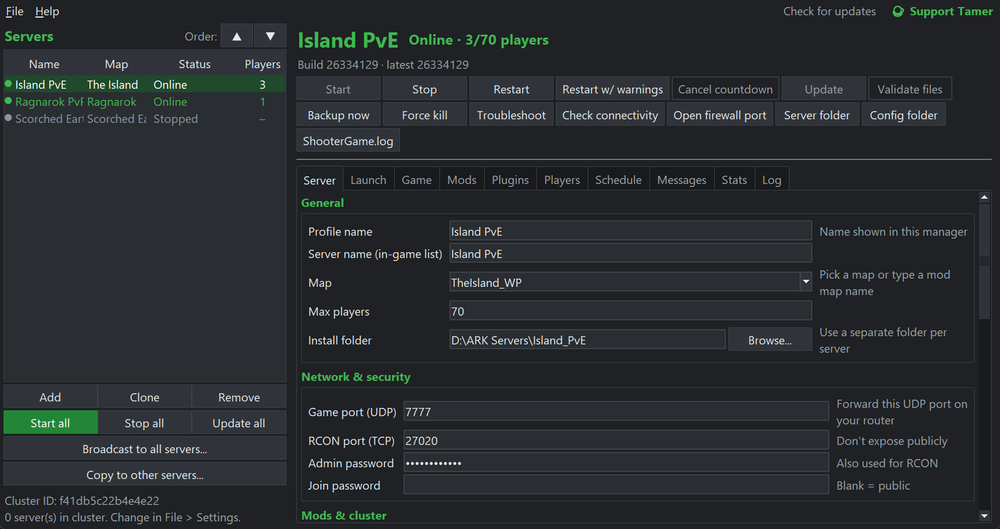
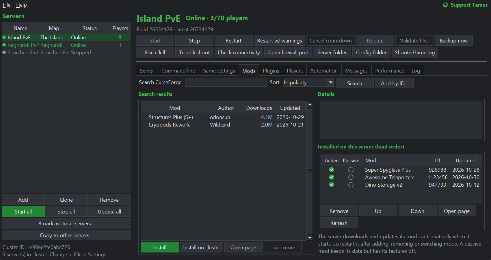
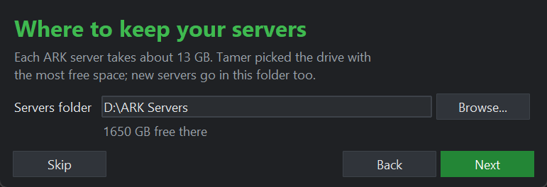

<h1 align="center">Tamer — Tame your server</h1>

A free Windows app for running <b>ARK: Survival Ascended</b> dedicated servers and clusters, without the command lines and batch files.

<a href="https://github.com/adam32885/Tamer/releases/latest"><b>⬇ Download Tamer for Windows</b></a> &nbsp;·&nbsp; <a href="CHANGELOG.md">What's new</a> &nbsp;·&nbsp; <a href="https://ko-fi.com/tamerarkmanager">☕ Support Tamer</a>

## Features at a glance
- **Install and update** ARK servers through SteamCMD, with a first-run welcome that sets up your first server for you.
- **Start, stop and restart** with in-game countdown warnings, **crash auto-restart**, and **scheduled restarts**.
- **Mods** from CurseForge: search, install, set the load order, use passive mods, and **auto-restart for mod updates**, waiting for an empty server if you like.
- **Clusters** for character and dino transfers between maps, and **copy settings** from one server to others.
- **Import your existing servers**, whether made by hand, with a .bat file or another manager: Tamer reads their settings, mods and INI files.
- **Backups** on a timer, with a second copy on another drive or the cloud.
- **Game settings** form plus full INI editors, and a **command line** builder.
- **AsaApi plugins:** install AsaApi and plugins in one click.
- **Discord alerts**, timed in-game messages, a **troubleshooter** that reads the logs for you, connectivity checks, and performance graphs.
- **Runs in the background** (tray and Windows service), with light and dark themes, and **updates itself**.

 

*Tamer is an unofficial tool. It isn't affiliated with or endorsed by Studio Wildcard.*

Tamer is free. If it saves you time, you can support it on **[Ko-fi](https://ko-fi.com/tamerarkmanager)**. There's a **☕ Support Tamer** link in the top-right corner of the window, and another under **Help**. Tamer is open source under the [MIT licence](LICENSE).

## Install
Run **`Tamer-Setup-<version>.exe`**. It installs Tamer just for you, with no admin prompt, into `C:\Users\<you>\AppData\Local\Programs\Tamer`, and adds it to the Start menu. Tick boxes in the installer add a desktop shortcut and start Tamer when you sign in to Windows. You don't need Python for the installed version.
- **Windows says "Windows protected your PC"?** The installer isn't code-signed yet. Click **More info**, then **Run anyway**.
- **Updating:** Tamer checks for new versions once a day. When one is out, a green **⬆ Update to x.y.z** link appears in the top-right corner. Click it to see what's new, then choose **Download and install**: Tamer downloads the new installer, closes and updates itself, keeps all your settings, servers and backups, and your ARK servers keep running. **Help > Check for Tamer updates now** checks straight away, and **File > Settings > General** can switch the daily check off. You can also download any version from the [releases page](https://github.com/adam32885/Tamer/releases) and run it over the top.
- **Uninstalling:** go to **Settings > Apps > Tamer > Uninstall**, or use **Uninstall Tamer** in the Start menu. Only the program is removed. Your settings, logs, backups and servers are kept; the uninstaller tells you where, and you can delete that folder yourself.
- **First run:** a short welcome sets up your first server. It picks where to keep your servers (it suggests the drive with the most free space, such as `D:\ARK Servers`), plus the name, map, players and ports, and can start the install, about 13 GB. New servers go in the same folder. **Help > Run the welcome again** sets up another server. You can still change any server's **Install folder** on the Server tab.

To run from source instead, see below.

## Requirements (running from source)
- Windows 10/11 (or Windows Server 2019+)
- Python 3.9 or newer from https://www.python.org/downloads/. During install, tick **"Add python.exe to PATH"**. Tkinter is included by default.
- Plenty of disk space (about 13 GB per server install) and RAM (12–16 GB per map is typical)

No other packages are needed.

## Start it
Double-click **`Start Tamer.bat`**, or run `python tamer.py`.

Tamer keeps everything next to itself:

| Folder | What's in it |
|---|---|
| `manager_data\config.json` | Your server profiles and settings |
| `steamcmd\` | SteamCMD (downloaded automatically) |
| `servers\<name>\` | Default install folder for each server |
| `backups\` | Save backups |
| `cluster\` | Shared cluster transfer data |

**Want a single .exe?** Run `build_exe.bat`. It produces `dist\Tamer.exe`, with Tamer's icon. Put that exe in its own folder, because it stores its data next to itself.

**Building the installer:** run `build_installer.bat`. It needs PyInstaller and Inno Setup 6 (`winget install JRSoftware.InnoSetup`). It builds `dist\Tamer.exe`, then `installer\Output\Tamer-Setup-<version>.exe`, using the version in `tamer.py`.

## First server in 5 steps
The welcome does steps 1 and 2 for you the first time Tamer opens.
1. Open the **Server** tab. Set a server name and map, check the ports, and click **Save server settings**.
2. Click **Install**. SteamCMD downloads and installs the server (app 2430930). The first install takes a while, and you can watch progress in **Log** tab.
3. Click **Open firewall port** and approve the admin prompt. On your router, forward the **game port (UDP)** to this PC. Do **not** forward the RCON port.
4. Click **Start**. Loading the map can take several minutes. The status goes from *Starting* to **Online** once RCON responds.
5. In-game, search for your server name in the Unofficial list. If it doesn't show up, enable "Show player servers".

## Clusters (several maps, character/dino transfers)
1. Click **Add** (or **Clone**) for each map. Every server gets its own install folder and unique ports automatically.
2. On each server, tick **Join the cluster**.
3. The **File > Settings** menu holds the shared **Cluster ID** and **cluster data folder**. All cluster servers must use the same ones, and Tamer handles that for you.
4. To limit what can be transferred, use **Game settings > Cluster transfers**.

## Features
- **Install / Update / Validate** through SteamCMD. The header shows the installed build, the latest build, and *UPDATE AVAILABLE* when there's a new one.
- **Stop** saves the world (`SaveWorld`) and exits cleanly (`DoExit`) over RCON. If players are online, it can count down with in-game warnings first.
- **Crash auto-restart**: after 5 crashes in 30 minutes it pauses and asks you to check `ShooterGame.log`.
- **Hide ARK's log window when using AsaApi** (Server tab > Behaviour, on by default): for servers started with AsaApi, the "ASA ... | Process ... | Mem ..." window ARK opens is hidden, so only the AsaApi window shows. Servers without AsaApi always keep ARK's window, so every server has one window. The server log is also on Tamer's Log tab. Untick the box to bring the window back, even while the server is running.
- **Scheduled restarts**: set daily times like `04:00, 16:00`. Players are warned at the minutes you choose, and the game can optionally update during the restart.
- **Auto-update on release**: optionally restarts with warnings when Wildcard pushes a new server build.
- **Game settings**: a form for common rates and rules (XP, taming, harvest, breeding, PvE, MOTD…) plus full raw editors for `GameUserSettings.ini` and `Game.ini`. Leave a form field blank to use ARK's default. Each save keeps a `.bak` copy.
  - Edit INI files while the server is **stopped**. ARK rewrites GameUserSettings.ini when it shuts down.
- **RCON console**: send any admin command. It shows a live player list with kick, ban and copy-ID, a live in-game chat feed, broadcast, and wiping wild dinos.
- **Backups**: automatic backups every N minutes while the server is online, plus manual backups and a retention limit. Backups include saves, player and tribe files, configs and (for cluster servers) cluster data. **Restore** moves the current saves aside instead of deleting them.
- **Mods tab**: search CurseForge's ARK: Survival Ascended mods by name. You can sort by popularity, last update, downloads or name, and read each mod's details.
  - **Install** adds a mod to the selected server. **Install on cluster** adds it to every server in the cluster. Double-clicking a result also installs it.
  - The server downloads and updates its mods automatically when it starts. If the server is running, Tamer offers a restart with player warnings.
  - The installed list sets the load order (Up/Down) and lets you remove mods. **Add by ID** takes the "Project ID" from a mod's CurseForge page.
  - Map mods: after installing one, set the Map field on the Server tab to the map name given on the mod's page.
  - Search works without setup through a free community proxy (api.curse.tools). For faster, more reliable searches, get a free personal key at https://console.curseforge.com/ and paste it under **File > Settings > CurseForge API key**.
  - Click **Test key** to check it. If CurseForge rejects your key, Tamer says so and keeps searching through the free proxy. Copy the key again from the console or generate a new one there.
- **Start when Tamer opens** (per server) and **Open this manager window when I log in to Windows** (Settings). Together they bring everything back up after a reboot.
- If you reopen Tamer while servers are still running, it finds them and takes over managing them again.

## Discord notifications
1. In Discord, open **Server Settings > Integrations > Webhooks > New Webhook**. Pick the channel, then click **Copy Webhook URL**.
2. In Tamer, open **File > Settings**, paste the URL and click **Send test**.
3. Choose which events to post:
   - online / stopped
   - crashes
   - restart countdowns
   - game and mod updates
   - players joining and leaving (off by default; it can get chatty)
   - high-memory alerts
4. Each server has a **Send Discord notifications** switch on its **Automation** tab.

## Mod update auto-restart
When a server comes online, Tamer records which version of each mod it loaded. Every 30 minutes by default (the interval is in Settings), it asks CurseForge whether any of those mods has a newer file.
- If **Restart automatically when an installed mod updates** is on (Automation tab), the server restarts with your usual player warnings. The new mod version downloads during startup.
- If it's off, you get a "MOD UPDATE" notice in the header and a Discord alert instead.
- To avoid interrupting players, also turn on **Wait until the server is empty before a mod update restart**. Tamer then waits until nobody is online and restarts without warnings. If the server is still busy after **Longest wait for an empty server** (2 hours by default, 0 = no limit), it restarts anyway with your usual warnings. The header and Discord show that it's waiting.
- If Tamer can't get the player list, it keeps waiting rather than guessing the server is empty.
- Tamer keeps waiting only while it stays open. If it closes during a wait, the update is applied at the next restart.
- To check right away, use **File > Check for mod updates now**.

## Performance monitoring
The **Performance** tab shows every server's CPU, memory, uptime and player count, plus this PC's total memory use. Below that are one-hour memory and CPU charts for the selected server; hover over a chart to see exact values.

**Restart if memory use goes above (GB)** is on the Automation tab. When a server stays above that limit for about 30 seconds, it restarts with player warnings.
- ASA servers use more memory the longer they run.
- Watch the chart for a day, then set the limit a few GB below the point where your PC starts to struggle.
- You also get a Discord alert if the whole PC goes over 92% memory.

## Timed messages & commands
The **Messages** tab holds scheduled messages and admin commands. They run while the server is online.
- **Type:** a Broadcast (a big on-screen message), a Chat message, or Admin command(s), one per line, e.g. `SaveWorld` or `DestroyWildDinos`.
- **Schedule:** every N minutes (counted from when the server comes online), or at set times on chosen weekdays.
- **Placeholders:** `{server}` `{map}` `{players}` `{max_players}` `{time}` `{next_restart}`, e.g. `{players}/{max_players} online - next restart {next_restart}`.
- **Buttons:** **Run now** sends a message immediately. **Copy to other servers** duplicates one to the rest of your servers. **Add examples** drops in three ready-made ones, switched off, for you to edit.

## System tray
Closing the window keeps Tamer running in the system tray, near the clock. Click the icon to reopen it, or right-click it and choose **Exit** to quit. You can change this, and choose to minimize to the tray, in **File > Settings > Tray & background service**.

## Background service (runs while logged out)
Without the service, automation only happens while Tamer is open. That covers crash restarts, schedules, backups, Discord alerts, timed messages and memory limits. Install the service in **File > Settings > Tray & background service > Install service**; you approve one admin prompt.
- It's a Windows startup task that runs Tamer without a window, even when nobody is logged in. Together with each server's **Start when Tamer opens**, your servers come back up by themselves after a reboot.
- When you open the Tamer window, the service pauses and the window takes control. When you close or exit the window, the service takes control back. If the service is in the middle of something, such as a restart countdown, the window waits for it to finish, or you can cancel the countdown.
- Service activity appears in each server's Log tab, marked `[service]`.
- It runs under your Windows account and stores no password. Accounts without admin rights may lack the "Log on as a batch job" right it needs.
- Removing the service never stops your game servers.

## Appearance
To switch themes, go to **File > Settings > General > Appearance** and choose **Match Windows** (the default), **Light** or **Dark**. The change applies instantly. With Match Windows, Tamer follows Windows' dark/light app setting automatically. The title bar and the File / Help menu bar follow the theme too. Alt+F and Alt+H open the menus.

Both themes use Tamer's green:
- The main buttons (**Start**, **Install / Update**, **Start all**, the mod **Install** button and the **Save** buttons) are green. They turn grey when they can't be used right now, for example Start while the server is already running.
- Each server in the list has a coloured dot: green is Online, yellow is Starting, grey is Stopped, red is Not installed and blue is Queued to start or busy.
- The server name, the "Servers" title, the section titles and the selected rows are green too.

## Second backup copy (another drive or the cloud)
In **File > Settings > General**, set a **Second backup folder**. If OneDrive, Dropbox or Google Drive is installed, a one-click button fills in its folder.
- Every backup, automatic or manual, is copied there and pruned to the same "Backups to keep" count.
- If the main backup drive dies, the Restore list still shows the copies, so you can restore straight from them. The **Stored in** column shows where each backup lives.
- **Back up saves before every game update** is on by default.
- Problems with backups and copies are reported to Discord (event: "Backup problems").

## Troubleshoot
Click **Troubleshoot** (second toolbar row) when a server won't start, keeps crashing or doesn't show up. It reads `ShooterGame.log` and checks this PC, then lists each problem in plain English with the fix:
- ports already in use
- missing Visual C++ runtime
- low disk space or RAM
- out-of-memory crashes
- maps that won't load (typos, DLC, mod maps)
- mod download/load errors
- crashes and damaged saves
- BattlEye problems
- Epic Online Services (server list) errors
- RCON not answering

The troubleshooter also runs by itself when a server crashes before it finishes starting, or is still starting after 20 minutes. Its findings go to the Log tab and to Discord (event: "Startup problems found").

## Check connectivity ("can players reach me?")
Click **Check connectivity** to walk the path from your server to the internet:
1. Is the server listening on its UDP game port?
2. Does Windows Firewall allow it?
3. What are your local and public addresses?
4. Does your router have a real public address? This catches **CGNAT** and double-router setups, where port forwarding can never work.
5. Does the router forward the port to this PC? Checked through UPnP.
6. Is the server publicly listed on BattleMetrics?

If your router supports UPnP, **Open port automatically** adds the port forward for you, and Tamer renews it every time the server starts. Without UPnP, the check tells you exactly what to forward and to which address.

This check uses three outside services: api.ipify.org for your public IP, your router's UPnP, and the BattleMetrics API.

BattleMetrics needs a free API token for the public-listing step:
1. Create a token at https://www.battlemetrics.com/developers.
2. Paste it into **File > Settings > General > BattleMetrics token**.

Without a token, that one step is skipped. The **Search BattleMetrics** button opens the search in your browser instead.

## Window
Tamer opens at a size that fits your screen and remembers its size, position and maximized state. Every tab works down to about 900×560: tables shrink instead of disappearing, and toolbars wrap onto extra rows. Drag the dividers to give a table more room.

## Update all servers
Click **Update all** (under the server list) or use **File > Update all servers...** to update every server one at a time. For each server in turn, Tamer:
1. Warns players, using that server's warning times.
2. Saves and stops the server.
3. Updates it with SteamCMD.
4. Starts it again and waits until it's back online.
5. Moves on to the next server.

Only one server is ever down at once.

- Servers already on the latest build are skipped.
- Servers that share an install folder are updated together.
- If an update fails, the server is started again on its current version so it doesn't stay down.
- **Cancel remaining** stops after the current server. If a warning countdown is running, it's cancelled and that server keeps running.
- You can close the window while it works. Progress goes to each server's Log tab, and Discord gets a summary at the end.

## Cluster tools
- **Start all, one at a time.** Each server waits for the previous one to come online before it starts, which avoids a big memory and CPU spike. This also applies when Tamer or the background service auto-starts your servers at boot. Servers waiting their turn show **Queued to start**. **Stop all** cancels the queue. You can switch this off in **File > Settings > General**.
- **Broadcast to all servers** (under the server list, or the File menu). Sends one message to every online server, as an on-screen broadcast and in chat.
- **Stagger restart times** (**Automation** tab > **Stagger across servers...**, or the File menu). Gives every server the same daily schedule spaced N minutes apart, e.g. 04:00 / 04:10 / 04:20, so the cluster never goes down at once. It shows each server's times before applying. Optionally it also copies the warning times and the update-on-restart setting.

## Import an existing server
Already running an ASA server you set up by hand, with a `.bat` file, or with another manager? Use **File > Import existing server...** (the welcome has a link to it too). Pick one of these:
- **A server that's running now.** This is the best option: Tamer reads exactly how it was started.
- **Its `.bat` start file.** Tamer understands `start "" ...`, lines continued with `^`, `set NAME=value` variables, `%~dp0` and `cd`.
- **Just its folder.** Tamer reads the INI files, and takes the map from the saves.

Tamer picks up:
- the map, server name, ports, max players and passwords;
- mods in their load order, and passive mods;
- the cluster ID and folder, and the active event;
- BattlEye, and the launch flags it knows. Any other `?options` and `-arguments` are kept in **Extra ?options** and **Extra -arguments**, so nothing is lost.

Before anything changes, you see a preview, with passwords hidden.

The server's files **stay where they are**. Nothing is copied or moved, so all its `GameUserSettings.ini` and `Game.ini` settings and its saves come with it, and appear on the **Game settings** tab.
- If its cluster ID differs from Tamer's, Tamer asks which one to use.
- If it's running, Tamer starts watching it straight away. Switch off any other manager that was restarting it, so the two don't both do it.
- If AsaApi is installed in its folder, tick **Start this server with AsaApi** on the Plugins tab if it used plugins.

## Copy to other servers
Select a server and click **Copy to other servers...** under the server list. Tick the servers to copy to, then what to copy:
- **Mods:** replaces the mod list, load order and passive mods.
- **Game settings:** replaces `GameUserSettings.ini` and `Game.ini`. The old files are saved next to the new ones, with `.before-copy-` and the date in their names.
- **Tamer settings:** automation, backups, command line options and similar.

Each server always keeps its own name, map, ports, passwords and install folder. Cluster, plugin, public IP, CPU core and auto-start choices aren't copied either. Timed messages have their own **Copy to other servers** button on the Messages tab.

Stop a server before copying game settings to it. ARK rewrites those files when it shuts down, so Tamer skips them on a running server and tells you. Mods and Tamer settings still copy, and apply at its next restart.

## Events
**Server** tab > **Advanced** > **Active event** sets ARK's `-ActiveEvent` launch option (WinterWonderland, FearEvolved, TurkeyTrial, Summer and so on). In ASA, most seasonal events are released as **official mods** instead. If nothing changes in game, click **Find event mod** to search the Mods tab for the event's mod, install it, then restart.

## Wipe / fresh start
In the **Automation** tab's Backups section, **Wipe / fresh start...** offers three levels:
- **Wild creatures only:** respawns every wild dino. The server must be online.
- **World only:** removes structures, tames and items. Players keep their characters and tribes.
- **Everything on this map:** a brand new world.

For cluster servers you can also clear the shared transfer data.

A backup is always taken first, so you can undo a wipe from the Backups list. File wipes need you to type **WIPE** to confirm. Settings, mods and other maps are never touched.

## Command line tab
The launch options for each server, all in one place. Ticked options are added to the launch command, and you can preview the full command at the bottom of the tab.
- **Who can join:** PC only (the default), all platforms (crossplay with Xbox and PlayStation), PC + Xbox, or PC + PlayStation. Sets `-ServerPlatform`.
- **Server language** (`-culture`): changes the server's own messages, not players' game language.
- **Network:**
  - **Public IP for the server list** (`-PublicIPForEpic`). Can be looked up automatically at every start.
  - **MultiHome**, for PCs with several network addresses, with the option to use that address for RCON too.
  - Leave these blank on a normal home PC.
- **CPU performance:** process priority and which CPU cores the server may use. Applied straight away and at every start. Giving each map its own cores stops a cluster fighting over the same ones.
- **Creatures:** respawn wild dinos at startup, no wild babies, flyers in caves, the various "no dinos" modes, and more.
- **Server mechanics:** game and tribe logs, whitelist-only (exclusive join), auto-destroy old structures, character tracker, net speed check, dynamic config, and more.
- **Anti-cheat and protection:** under-mesh checking and killing, anti speed-hack, hang detection, cosmetic validation.
- **Cluster:** `-NoTransferFromFiltering`.
- **Threads (advanced):** leave these off unless you know you need them.

A flag you've also typed into **Extra -arguments** isn't added twice.

Two things are left out on purpose:
- **Save-format conversion**, because it can't be undone.
- **Colour-event flags.** You can still add those in Extra -arguments.

## Passive mods
In the **Mods** tab, each installed mod has an **Active** circle and a **Passive** circle at the left of its row. The green tick shows which one is on. Click the empty circle to switch the mod.
- A passive mod is still downloaded, updated and loaded. Its items, structures and dinos stay in the save, but its features are switched off.
- Use it to retire a mod or an ended event without losing anything built with it, or so a cluster map can accept transfers of creatures and items from a mod it doesn't run.
- Tamer adds `-passivemods=ID` and lists passive mods first in `-mods=`, as ARK requires. The **Command line** preview shows the result.
- Takes effect the next time the server restarts.

## Plugins (AsaApi)
The **Plugins** tab installs and manages **AsaApi**, the community server-plugin framework from ark-server-api.com (not made by Studio Wildcard).
- **Install / update AsaApi** downloads the latest release from GitHub (ArkServerApi/AsaApi) into the server's `Binaries\Win64` folder.
  - **Install from .zip...** installs a release you downloaded yourself.
  - **Install on all servers** does every server folder.
  - Updating keeps your AsaApi `config.json` (the new defaults are saved as `config.json.default`) and never touches installed plugins.
- **Start this server with AsaApi** launches the server through `AsaApiLoader.exe`. Crash detection, CPU priority and core settings, and memory monitoring all follow the real server process.
- **Plugins:**
  - **Install plugin (.zip)** works with both common zip layouts. Updating a plugin keeps its `config.json`.
  - **Plugins folder** opens the folder that holds all the plugins (`Win64\ArkApi\Plugins`).
  - You can also enable or disable a plugin, **Edit config**, open the **Selected plugin's folder** and **Remove** it.
  - **Reload now** reloads a plugin on a running server, using AsaApi's `plugins.unload` / `plugins.load`.
- **Remove AsaApi** deletes only AsaApi's own files. Your plugins and settings stay.
- The **Troubleshooter** flags AsaApi switched on but not installed, and errors in AsaApi's logs (`Win64\logs`).
- After an ARK update, AsaApi and plugins sometimes need updates too. If a server stops starting, untick **Start this server with AsaApi** until they catch up.

## Good to know
- Servers keep running if you close Tamer. Crash restarts, schedules and auto-backups only work while it is open, so leave it running (minimized is fine).
- The admin password is also the RCON password. Profiles are stored in plain text in `manager_data\config.json`, so keep that folder private.
- **Extra ?options** are appended to the map URL (e.g. `AllowCrateSpawnsOnTopOfStructures=True`).
- **Extra -arguments** are appended as command-line flags (e.g. `-ForceAllowCaveFlyers`).
- You can type a mod map's name into the Map box.
- If a server says *Starting* for more than 20 minutes, open `ShooterGame.log`. Usual causes are missing DLC (Astraeos and Lost Colony are paid), a port already in use, or not enough RAM.
- Update checks use the public `api.steamcmd.net` service. You can turn them off in Settings by setting the interval to 0.

## Upgrading from "ARK Ascended Server Manager"
Unzip Tamer into the same folder as before. Your servers, settings, backups and logs carry over, because they live in `manager_data` and the other folders.
- `ark_manager.py` is still included as a small launcher, so old shortcuts, the old startup entry and an already-installed background service keep working.
- To move the background service to the new name, open **File > Settings > Tray & background service**, click **Remove service**, then **Install service** again.
- You can delete the old `Start ARK Server Manager.bat`. Use `Start Tamer.bat` instead.
